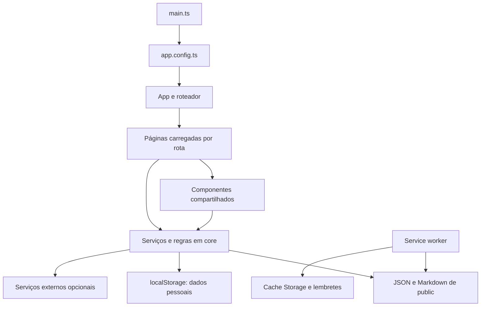

# Reconhecimento do Sistema — Bíblia Sagrada

Data: 09/11/2026, fuso America/Cuiaba. Base examinada: branch `dev`, commit `3f90bc8` (`Reverte publicações de hoje`).

Este documento registra o reconhecimento da arquitetura, das funcionalidades, do código, dos dados, dos testes e da publicação presentes neste checkout. Foram examinados os pontos de entrada, as rotas, os serviços, as telas, os componentes compartilhados, os geradores de dados e a configuração de produção. As verificações executadas estão descritas ao final. Não houve alteração no código do aplicativo, publicação ou mudança nos dados pessoais.

O reconhecimento é estrutural e funcional: não inclui revisão individual de todos os versículos, validação histórica ou teológica de cada texto, auditoria de segurança completa ou confirmação do estado atual do site publicado.

## 1. Visão geral

O sistema é uma aplicação web de página única, instalável como PWA, voltada à leitura da Bíblia, ao estudo e à preparação de aulas e sermões. A interface é em português brasileiro e os identificadores do código são predominantemente em inglês.

O repositório contém o aplicativo executado no navegador e ferramentas de preparação de conteúdo. Não foi identificado backend próprio, banco de dados remoto, login ou sincronização de contas. Os dados pessoais são armazenados no navegador; o conteúdo distribuído com o aplicativo fica em arquivos estáticos.

| Tecnologia | Uso e versão encontrada no ambiente |
|---|---|
| Angular | Componentes standalone, injeção de dependências, roteamento e signals; núcleo 21.2.25 |
| Angular Material e CDK | Controles, painéis, diálogos e acessibilidade; 21.2.14 |
| TypeScript | Código e modelos, com verificações estritas; 5.9.3 |
| RxJS | HTTP, composição assíncrona e cache em memória; 7.8.2 |
| HTML e SCSS | Templates, estilos responsivos e temas |
| Angular Service Worker | Instalação, atualização e cache offline |
| Playwright | Testes de lógica e de navegador; 1.64.1 |
| ESLint e angular-eslint | Verificações de TypeScript e templates |
| Python e Node.js | Preparação de Bíblia, mapas, fontes, referências e áudio |
| GitHub Actions e Pages | Verificação e publicação estática configuradas no repositório |

Ambiente usado nas verificações: Node.js 24.15.0 e npm 11.12.1. As versões acima são as instaladas localmente; `package.json` declara intervalos e `package-lock.json` registra a resolução.

## 2. Dimensão e organização

| Área | Inventário |
|---|---|
| `src/` | 232 arquivos: 194 TypeScript, 15 HTML e 23 SCSS; 41.677 linhas ao todo |
| `src/app/core/` | 84 arquivos TypeScript de serviços, modelos, regras e catálogos |
| `src/app/pages/` | 85 arquivos em 49 pastas, incluindo 56 arquivos TypeScript |
| `src/app/shared/` | 54 arquivos, incluindo 50 TypeScript |
| Componentes Angular | 103 arquivos com declaração `@Component` |
| Rotas | 65 entradas: 61 com `loadComponent` e quatro redirecionamentos, incluindo a rota curinga |
| `e2e/` | 57 arquivos de especificação: 28 de lógica e 29 de navegador |
| `tools/` | Nove scripts Python, um script Node.js e o guia de uso; excluídos caches |
| `public/` | 1.911 arquivos, aproximadamente 121,6 MB brutos |

As entradas de rota não equivalem a telas distintas: algumas reutilizam o mesmo componente com parâmetros diferentes. O tamanho de `public/` também não equivale ao download inicial, pois grande parte das versões bíblicas é armazenada sob demanda.

| Caminho | Responsabilidade |
|---|---|
| `src/main.ts` | Registra a localidade e inicializa o Angular |
| `src/app/app.config.ts` | Configura HTTP, roteador, parâmetros de componentes e service worker |
| `src/app/app.routes.ts` | Define os endereços e carrega as páginas |
| `src/app/app.ts`, `app.html`, `app.scss` | Estrutura geral, seis abas, avisos e player de áudio |
| `src/app/core/` | Regras, serviços, tipos e índices de conteúdo |
| `src/app/pages/` | Telas associadas às rotas |
| `src/app/shared/` | Componentes reutilizados, mapas, renderizadores e painéis |
| `src/styles.scss`, `_theme-colors.scss` | Aparência global, tokens e temas |
| `public/bible/` | Textos bíblicos por versão/livro e referências cruzadas |
| `public/conteudo/` | JSON, Markdown e imagens de estudo |
| `public/maps/` | Geografia projetada para os mapas SVG |
| `public/fonts/` | Fontes e ícones hospedados localmente |
| `public/audio/` | Índice previsto para gravações de narração |
| `public/sw.js`, `ngsw-config.json` | Lembretes no service worker e política de cache |
| `.github/workflows/` | Verificação e publicação |

As pastas locais `EBD - Revista/` e `Livros/` são materiais de consulta excluídos do Git. `Teologos/` contém duas imagens de referência, sem código. `Teologos/` e `.playwright-mcp/` já estavam sem rastreamento no início e foram preservadas.

## 3. Como o aplicativo se conecta

O estado da interface usa `signal`, `computed` e `effect`; operações HTTP usam `HttpClient` e RxJS, com conversões por `toSignal`. As rotas usam `withComponentInputBinding()` para entregar parâmetros às páginas. Os templates utilizam `@if` e `@for`.

O componente principal organiza as abas Início, Bíblia, História, Ensino, Jornal e Meu espaço. Também inicializa verificação de novidades, lembretes, avisos de falha ao salvar e serviços de instalação/atualização. O player de áudio permanece na estrutura geral para acompanhar a navegação.

## 4. Telas e funcionalidades

| Área | Rotas e recursos |
|---|---|
| Início | `/`: continuação da leitura, fitinha, versículo, histórias, curiosidades e datas |
| Bíblia | `/livros`, `/livro/:book`, `/ler/:book/:chapter`, `/busca`: livros, capítulos, leitura, comparação e pesquisa |
| Biblioteca | `/historia`, `/artigo/:id`, `/estudo/livros`: estante, trilhas, artigos e estudo por livro |
| Tempo e história | `/epocas`, `/epocas/:id`, `/datas`, `/assembleia-de-deus`, `/assembleia-de-deus/linha-do-tempo`, `/assembleia-de-deus/:id` |
| Pessoas e famílias | `/memorial`, `/memorial/:id`, `/genealogia`, `/tribos`, `/tribos/:id` |
| Mapas | `/mapas`, `/mapas/:id`, `/atlas`: jornadas, geografia, épocas e camadas |
| Consulta | `/dicionario`, `/dicionario/:id`, `/profecias`, `/profecias/:id`, `/curiosidades`, `/curiosidades/:id` |
| Harpa e sermões históricos | `/harpa`, `/harpa/:n`, `/avivamento`, `/avivamento/:id` |
| Quiz | `/quiz`, `/quiz/capitulo/:book/:chapter`, `/quiz/livro/:book`, `/quiz/historia/:id` |
| Ensino | `/ensino`, `/ibuc`, `/ibuc/:turma`, `/ibuc/aula/:id`, `/ebd/apoio`, `/ebd/apoio/:turma`, `/ebd/apoio/aula/:id` |
| Organização da EBD | `/ebd`, `/ebd/licao/:number`: trimestre, revista, leituras e anotações |
| Sermões pessoais | `/sermoes`, `/sermoes/:id`, `/sermoes/:id/pregar`: editor e modo púlpito |
| Vida devocional | `/meu-espaco`, `/devocional`, `/devocional/:date`, `/anotacoes`, `/anotacoes/:id`, `/favoritos` |
| Jornal | `/vozes`, `/vozes/:id`, `/revisao/:token`: matérias em vários idiomas e prévia de revisão |
| Configuração e documentação | `/ajustes`, `/novidades`, `/fontes`, `/creditos` |

`/estudo` redireciona para `/historia`. Dois endereços antigos de artigos redirecionam para o estudo que os reuniu; a rota curinga leva ao início. IBUC e o organizador da revista continuam implementados e acessíveis por endereço, embora seus cartões estejam ocultos no menu Ensino por decisão registrada no projeto.

### Leitura bíblica

`pages/reader/reader.ts` reúne o capítulo principal, a comparação de versões, dicionário, notas de estudo, mapas, artigos relacionados e profecias. Permite navegar por capítulo, usar gestos, ajustar a aparência, ouvir, marcar a fitinha e abrir ações do versículo para copiar, compartilhar ou salvar um destaque/favorito.

Quando uma tradução parcial não possui o livro do Antigo Testamento, o leitor pode mostrar a Almeida com aviso. Texto hebraico tem tratamento de direção da escrita. A disponibilidade de livros e lacunas de tradução é tratada separadamente de uma falha genérica de carregamento.

### Histórias e estudo

`library.ts` cataloga os textos; `trails.ts` organiza assuntos e subdivisões; `library-bays.ts` reúne ferramentas na biblioteca. `story-graph.ts` calcula continuidade e relações entre histórias; `story-progress.service.ts` guarda a posição de leitura. `epochs.ts` relaciona capítulos, pessoas, mapas e histórias a 16 épocas.

`rich-text-parser.ts` interpreta o Markdown ampliado, e `shared/rich-text.ts` o apresenta. Além de títulos e parágrafos, o formato aceita referências `[[Jo 3.16]]`, notas, cenas, personagens, fichas, figuras, mapas e cartões para outros artigos. `sources.ts` mantém o catálogo de fontes.

Os mapas são SVG, sem servidor de mosaicos. `shared/bible-map.ts` desenha a geografia, lugares, trajetos, escala, distâncias, zoom e camadas. `shared/map-story.ts` apresenta jornadas com etapas, narração e passagens bíblicas.

### Ensino, dados pessoais e jornal

Apoio EBD e IBUC compartilham páginas, diferenciadas pelos dados da rota. Há dez módulos EBD do quarto trimestre de 2026, com 13 lições por turma, construídos por `ebd-builder.ts`. O organizador pessoal da EBD fica em `ebd.service.ts`.

Anotações, devocionais, pedidos de oração, favoritos e sermões têm serviços próprios. O modo púlpito apresenta o esboço com partes, ampliação e cronômetro.

O jornal usa `guest-sermons.ts`, `pages/voices/`, `shared/news-text.ts` e `shared/voice-article.ts`. Há estados de publicação, idiomas, histórico de alterações editoriais e identificação da versão do texto para a resposta do autor. A prévia de revisão é um fluxo executado no cliente; não representa autenticação de servidor.

## 5. Serviços e fluxos de dados

| Serviço ou grupo | Responsabilidade |
|---|---|
| `bible.service.ts` | Carregar capítulos/livros locais ou remotos, compartilhar cache e limitar pedidos à API |
| `content.service.ts` | Carregar e memorizar JSON e Markdown de estudo |
| `search.service.ts` | Montar índice e pesquisar o texto da Almeida |
| `study-search.service.ts`, `study-search.ts` | Pesquisar conteúdo de estudo por título, texto, termos e sinônimos |
| `cross-references.service.ts` | Unir citações curadas e referências automáticas |
| `settings.service.ts` | Versão, comparação, aparência, camadas, fitinha e progresso bíblico |
| `favorites.service.ts`, `notes.service.ts`, `sermons.service.ts` | Dados pessoais de cada funcionalidade |
| `devotional.service.ts`, `ebd.service.ts` | Diário, oração, leituras e organização de aulas |
| `story-progress.service.ts`, `quiz.service.ts` | Continuidade das histórias e resultados dos jogos |
| `storage.service.ts`, `backup.service.ts` | Gravação, detecção de falhas, persistência e backup |
| `listen.service.ts`, `voice.ts`, `speech-split.ts` | Voz do aparelho, divisão do texto e reprodução de gravações |
| `pwa.service.ts` | Instalação, atualização e estado de conexão |
| `notify.service.ts`, `reminders.service.ts` | Fila de avisos, agenda e notificações |
| `navigation.service.ts`, `ui.service.ts` | Histórico de navegação e comportamento das barras |
| `voices-news.service.ts`, `whats-new.service.ts`, `curiosities.service.ts` | Matérias vistas, novidades e curiosidade do dia |
| `libras.service.ts` | Carregamento opcional do widget VLibras |

**Abrir um capítulo:** rota → `ReaderPage` → `BibleService` → índice local → JSON do livro ou API → linhas de versículos. O serviço mantém livros e capítulos em memória com `shareReplay(1)`. A fila remota permite 12 pedidos por janela de 30 segundos; erros interpretados como limitação podem causar três novas tentativas. Versões exclusivamente locais não recorrem à API.

**Pesquisar a Bíblia:** `SearchService` carrega os 66 livros da Almeida em lotes de oito, monta o índice em memória e pesquisa sem distinguir acentos ou maiúsculas. Conta todos os resultados e apresenta até 300. A versão escolhida no leitor não muda a base dessa busca.

**Pesquisar estudos:** o índice é montado sob demanda a partir de artigos, estados, sermões históricos, memorial, dicionário, profecias, curiosidades, hinos, épocas e fatos. O jornal Novas Vozes ainda não participa desse índice.

**Salvar uma informação pessoal:** ação da página → signal do serviço → effect → serialização no `localStorage`. A função `saveLocal` registra falhas e o aplicativo apresenta um aviso. O `StorageService` também solicita armazenamento persistente quando encontra dados pessoais.

**Exportar/restaurar:** o backup coleta chaves `biblia.*`, gera JSON e permite baixar ou compartilhar. A restauração substitui os dados atuais; mantém uma cópia temporária em memória e tenta repor os anteriores se a gravação falhar. O arquivo é o mecanismo de transferência entre aparelhos disponível no projeto.

## 6. Conteúdo e ferramentas de preparação

| Conteúdo | Quantidade encontrada |
|---|---|
| Versões bíblicas locais | 29: 19 com 66 livros indexados e dez com 27 |
| Arquivos de livros bíblicos | 1.524 |
| Referências cruzadas | 66 arquivos; 26.718 versículos com relações |
| Artigos Markdown | 101 |
| Histórias estaduais | 27 |
| Sermões históricos Markdown | Nove |
| Textos do jornal | Seis arquivos, um por idioma da matéria atual |
| Dicionário e memorial | 184 verbetes e 145 personagens |
| Profecias e citações AT/NT | 50 profecias e 146 citações |
| Introduções e notas | 66 introduções de livros e notas para 68 capítulos |
| Harpa | 13 hinos catalogados e cinco autores; sem letras |
| Geografia | 16 arquivos JSON |
| Gravações de áudio | Nenhum MP3; índice de áudio vazio |

Os números de livros expressam o inventário do índice, sem garantir equivalência textual ou completude de cada capítulo em todas as traduções.

| Ferramenta | Função |
|---|---|
| `baixar-almeida.py` | Obter os capítulos de origem |
| `gerar-almeida.py` | Converter para JSON por livro, aplicar limpeza e correções e escrever o índice |
| `corrigir-almeida.py` | Reaplicar correções sem novo download |
| `gerar-versoes.py` | Converter VPL de outras versões e atualizar o índice |
| `sword-para-vpl.py` | Converter fontes SWORD para o formato intermediário |
| `gerar-referencias.py` | Preparar relações da base OpenBible |
| `gerar-mapas.py` | Recortar e projetar geografia Natural Earth |
| `baixar-fontes.py` | Preparar fontes locais e subconjunto de ícones |
| `verificar-base.py` | Localizar assuntos existentes e possíveis repetições |
| `gerar-audio.mjs` | Sintetizar narração por Azure/ElevenLabs e produzir índice de sincronização |

As ferramentas são processos de manutenção separados do aplicativo. Não foram executados downloads, regenerações de conteúdo ou chamadas de síntese de áudio durante este reconhecimento.

As regras locais pedem manter referências e fontes, evitar duplicação de assuntos e respeitar as licenças registradas em `CREDITOS.md` e `core/credits.ts`. Alterações da Almeida passam pelos geradores. Revistas e livros de consulta locais ficam fora da publicação. A orientação técnica está em `CLAUDE.md`; o histórico de decisões, em `DIARIO.md`; a revisão editorial, em `REVISAO-DE-CONTEUDO.md`.

## 7. Offline, áudio e integrações

O service worker é registrado somente em produção. `public/sw.js` incorpora o worker Angular e acrescenta os lembretes. O aplicativo aberto faz verificações periódicas; com o aplicativo fechado, usa sincronização periódica quando suportada, cuja execução depende do navegador. Não há servidor próprio de push.

O manifesto `ngsw.json` gerado nesta análise confirmou:

| Grupo | Estratégia | Arquivos | Tamanho bruto |
|---|---|---:|---:|
| `app` | Antecipado | 137 | 2,97 MB |
| `assets` | Antecipado | 149 | 11,19 MB |
| `bible-almeida` | Antecipado | 67 | 4,14 MB |
| `conteudo` | Antecipado | 150 | 1,87 MB |
| `imagens-das-datas` | Sob demanda | 0 | 0 |
| `versoes-portugues` | Sob demanda | 1.458 | 101,38 MB |
| `referencias` | Sob demanda | 66 | 1,91 MB |

O conjunto antecipado soma aproximadamente **20,17 MB brutos**, antes da compressão HTTP. Inclui arquivos JavaScript de rotas: o carregamento sob demanda do roteador e o download antecipado do service worker são mecanismos diferentes. Apesar do nome, `versoes-portugues` também contém versões em outros idiomas.

| Integração | Papel e limite observado |
|---|---|
| `bible-api.com` | Texto das versões remotas; possui fila/repetição no cliente e cache configurado |
| YouVersion / `bible.com` | Links para versões externas; esses textos não são incorporados por esse mecanismo |
| Web Speech API | Narração com as vozes disponíveis no dispositivo |
| Áudio publicado | Suporte a MP3 e sincronização por trecho; não há gravações no checkout atual |
| VLibras | Widget externo opcional, carregado quando ativado |
| Web Share, área de transferência e WhatsApp | Compartilhamento iniciado pela pessoa; imagens são desenhadas em canvas com QR code |
| Azure e ElevenLabs | Usados pelo gerador de áudio fora do aplicativo, com credenciais de ambiente |

Fontes, Almeida e conteúdo contemplado pelos grupos antecipados ficam disponíveis após a instalação completa do cache. Outras versões locais são guardadas à medida que seus arquivos são usados. Mapas e áudio têm as limitações descritas abaixo.

## 8. Pontos de atenção encontrados

Nenhum dos pontos foi corrigido neste reconhecimento. A tabela distingue constatação em configuração/artefato de comportamento deduzido pela leitura do código.

| Ponto | Evidência e consequência |
|---|---|
| Geografia dos mapas fora do cache offline | **Confirmado no build:** nenhum `/maps/*.json` aparece no `hashTable` de `ngsw.json`. `ngsw-config.json` não contempla esses arquivos; `shared/bible-map.ts:297` os solicita e retorna `null` em falha. A disponibilidade da geografia offline não é garantida pelo service worker. O comportamento visual não foi reproduzido nesta análise. |
| Fotos de datas entram no download antecipado | **Confirmado no build:** 41 fotos `datas-*.jpg` ficaram em `assets`; o grupo `imagens-das-datas` ficou vazio. O padrão amplo em `ngsw-config.json:20` captura as imagens antes do grupo sob demanda. Essas fotos representam cerca de 4,24 MB brutos. |
| Regeneração da Almeida substitui o índice inteiro | **Confirmado no código:** `tools/gerar-almeida.py:109` escreve apenas a chave `almeida` em `index.json`. Rodá-lo sozinho na base atual removeria do índice as outras 28 versões, mantendo seus arquivos no disco. A sequência de manutenção precisa reconstruir essas entradas. |
| Versão atribuída às ações de um texto substituto | **Dedução estática:** `reader.ts:100` pode apresentar Almeida como alternativa; `openVerse` em `:348` e `verseRef` em `:443` continuam usando a versão selecionada. `shared/verse-sheet.ts:149` usa esses dados ao copiar/compartilhar, e `:153` ao salvar. O texto pode receber a identificação da tradução originalmente escolhida. Falta reprodução em navegador. |
| Validação interna de backup incompleta | **Confirmado no código:** `backup.service.ts:54` verifica identificador, objeto e valores string, mas não a versão do formato ou o esquema do JSON contido em cada chave. **Consequência inferida:** um valor string contendo `{}` para a lista de notas seria aceito, embora `notes.service.ts:35` espere uma lista e use `.filter()`. Não foi importado backup de teste nesta análise. |
| Ações de versículo sem acionamento por teclado | **Confirmado no template:** `reader.html:153` e `:164` registram exceções do lint para elementos clicáveis sem o caminho equivalente de teclado. |
| Progresso bíblico registrado ao abrir a rota | **Dedução estática:** `reader.ts:237` chama `markRead` sem depender do sucesso do carregamento; uma tentativa com erro pode contar como capítulo lido. |
| Dados pessoais restritos ao navegador | **Limite arquitetural:** não há sincronização remota. O pedido de armazenamento persistente e o arquivo de backup são as proteções implementadas. Algumas preferências de áudio usam chaves sem o prefixo `biblia.` e ficam fora do backup. |
| Testes visuais e offline fora do CI | **Confirmado nos workflows:** a publicação exige lint, lógica e build; os projetos de navegador e produção offline não são executados pelo CI configurado. |
| Documentação com descrições antigas | `README.md` informa Node 20 ou superior, enquanto os workflows usam 24. `PONTOS-FRAGEIS.md` mantém problemas históricos e suas resoluções. `CLAUDE.md` tem trechos repetidos de compartilhamento/datas com descrições divergentes. Para comportamento atual, consultar código, configuração e validações deste checkout. |

A classificação de falhas remotas também merece revisão futura: `bible.service.ts:27` trata status HTTP `0` com o navegador online como limitação de pedidos. Esse status pode representar outras falhas e provocar esperas que não resolvem a causa.

Os testes de conteúdo verificam estrutura, referências, vínculos e cadastro de fontes. Aprovação nesses testes não confirma, por si só, os fatos históricos e teológicos ou a qualidade das traduções.

## 9. Testes, publicação e validação executada

Os testes de navegador usam Google Chrome, com projetos de celular e computador. A fixture `e2e/base.ts` fiscaliza erros de JavaScript, console e rede, limpa os dados pessoais de cada teste e simula a API bíblica por padrão. Os testes de lógica importam as regras TypeScript diretamente e dispensam o navegador.

Há cobertura para referências, ligações entre conteúdos, arquivos, fontes, quiz, épocas, temas, traduções, navegação, leitor, editores, backup, áudio, compartilhamento e acessibilidade. A suíte de produção offline cobre Almeida, busca, estudo, worker e notificações; não inclui geografia dos mapas.

Embora `package.json` tenha um script `test` que chama `ng test`, `angular.json` não define um alvo de testes unitários. A infraestrutura de testes efetivamente configurada é Playwright.

| Verificação executada em 09/11/2026 | Resultado |
|---|---|
| `npm run lint` | Aprovado, sem problemas reportados |
| `SO_LOGICA=1 npx --no-install playwright test --project=logica --workers=2 --reporter=line --output=/tmp/biblia-reconhecimento-logica` | 168 aprovados em 26,8 segundos |
| `npm run build -- --output-path /tmp/biblia-reconhecimento-build` | Build de produção aprovado, sem avisos reportados |
| Inspeção do `ngsw.json` produzido | Confirmados os grupos, tamanhos, fotos antecipadas e ausência dos mapas |

O build informou pacote inicial de aproximadamente **1,00 MB bruto**, com transferência estimada de **267,16 kB** para esse conjunto de JavaScript/CSS. Esse valor não inclui todo o conteúdo do cache de instalação. Os artefatos foram gerados em `/tmp`, preservando o `dist/` existente.

Não foram executadas nesta rodada as suítes completas de celular, computador ou produção offline. Também não foram verificadas a API real, as vozes em dispositivos, as notificações com o aplicativo fechado ou a publicação no GitHub. Os resultados acima não equivalem à validação de todos esses ambientes.

O workflow `testes.yml` executa `npm ci`, lint, lógica e build em envios para `dev` e em pull requests para `main`/`dev`. `publicar.yml` repete as verificações e publica somente `main`, ajusta o caminho base do repositório e copia `index.html` para `404.html` para atender rotas internas no GitHub Pages. Não foi feito commit, push ou deploy durante este reconhecimento.

## 10. Referências para próximas alterações

| Mudança pretendida | Arquivos que normalmente precisam ser examinados juntos |
|---|---|
| Nova página | `app.routes.ts`, grupo de navegação em `app.ts`, hub/estante correspondente e testes de navegação |
| Leitura e versões | `reader/`, `bible.service.ts`, `versions.ts`, `models.ts`, `public/bible/index.json` e cache offline |
| Artigo de estudo | `verificar-base.py`, `library.ts`, `trails.ts`, Markdown, `sources.ts` e testes de vínculos/conteúdo |
| Nova geografia ou mapa | `maps.ts`/`church-maps.ts`/`atlas.ts`, `gerar-mapas.py`, `public/maps/` e política de cache |
| Dados pessoais | Serviço da funcionalidade, `saveLocal`, leitura/validação, backup e testes de dados |
| Narração | `listen.service.ts`, `audio-text.ts`, `listen-dom.ts`, `gerar-audio.mjs` e índice de áudio |
| Aparência | `styles.scss`, tokens, `settings.service.ts`, estilos da página e testes de temas/acessibilidade |
| Nova imagem ou ícone | Arquivo, legenda/crédito, `credits.ts`, `CREDITOS.md`, gerador de fontes quando aplicável e cache |
| Publicação | Workflows, build com caminho base correto e fluxo de PR de `dev` para `main` |

O projeto já separa telas, componentes e serviços e possui verificações estruturais extensas. O reconhecimento fornece os pontos de entrada para manutenção; os achados de cache, índices, backup e identificação da tradução são candidatos concretos a uma próxima revisão.
